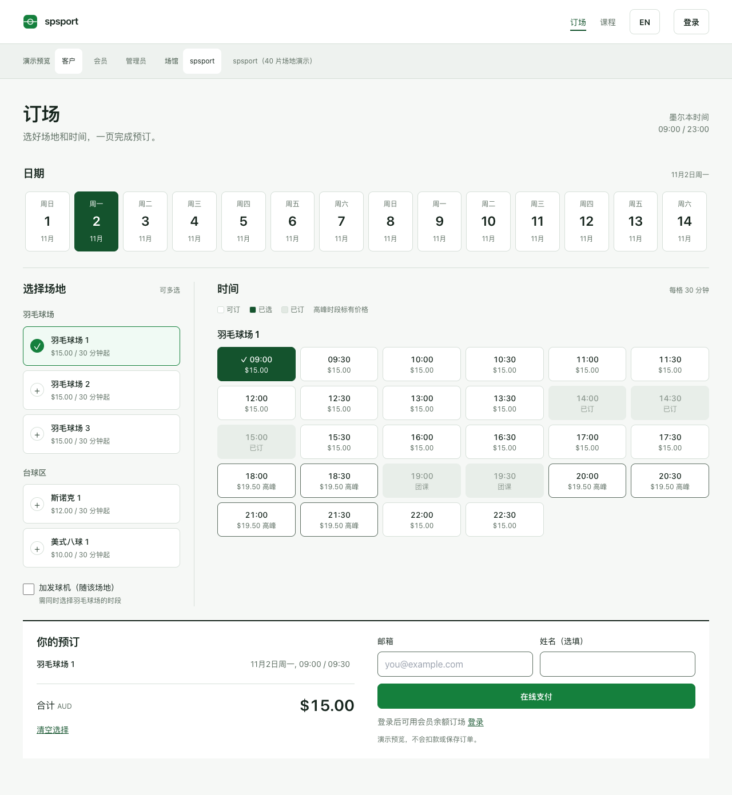

# spsport 场地预订与会员系统

一个可下载、可修改的开源场地预订项目。包含中英双语界面、羽毛球场与台球时段选择、会员和团课管理示例，采用 [MIT 开源协议](LICENSE)。

**第一次使用？从 [零基础操作教程](docs/GETTING_STARTED.zh-CN.md) 开始。** 不需要编程经验，不需要付款密钥，也不需要先注册数据库。

## 先知道这三件事

1. **开源的是程序，不是客户资料。** 演示身份使用编号，邮箱仅使用 `example.com` 占位地址，没有真实会员名单或可使用的密钥。
2. **现在可以运行演示版。** 演示预订不扣款、不发通知、不保存真实订单。请用示例内容体验，不要输入真实个人资料。
3. **现在不能直接拿来正式收款。** 线上支付入口已关闭，无法用环境变量绕过。正式经营需要先完成 [待解决问题与验收](docs/REVIEW.zh-CN.md)。

## 你想做什么？

| 你的目的 | 从这里开始 | 完成后会得到什么 |
|---|---|---|
| 在自己电脑上看看效果 | [新手教程：第 1–5 步](docs/GETTING_STARTED.zh-CN.md) | 本地演示页面 |
| 不使用命令行，在 Lovable 里体验 | [Lovable 分步教程](docs/LOVABLE_SETUP.md) | 独立的演示项目 |
| 分享一个网页链接给别人 | [新手教程：发布演示站](docs/GETTING_STARTED.zh-CN.md#6-发布只含示例数据的演示网站) | 只含示例数据的公开网站 |
| 修改场地数量和价格 | [场地配置说明](docs/VENUE_CONFIG.md) | 自定义 spsport 演示配置 |
| 用测试数据库保存数据 | [测试数据库配置](LOVABLE_DEPLOY.md) | 独立测试环境，不是生产验收 |
| 修改代码或贡献功能 | [贡献指南](CONTRIBUTING.md) | 可复核的修改与测试结果 |

## 预订方式

在同一页依次选择日期、场地、时段，下面的订单摘要同步显示价格。可以选择多个场地，连续时段会合并。手机底部提供总价和「查看并预订」入口。

- 每格 30 分钟，金额为 AUD。
- 高峰时段直接标注价格。
- 发球机需要同时段的羽毛球场。
- 支持系统「减少动态效果」设置。
- 当前时区固定为 `Australia/Melbourne`，包含夏令时。



## 熟悉命令行的人可以快速开始

安装 Node.js 22.12 或以上版本。下载仓库 ZIP 并解压，在项目文件夹打开终端，然后逐行运行：

```bash
npm ci
npm run dev
```

打开终端显示的 `http://127.0.0.1:5173`。不用创建 `.env`，也不用填写密钥。停止时在终端按 `Ctrl+C`。

## 安全与隐私先于发布

- 只发布源代码、示例配置与经过检查的演示截图。
- `.env`、密钥、数据库备份、客户表格、聊天记录和后台截图都不能上传。
- 任何 `VITE_` 变量都会进入浏览器，只能包含公开配置。
- Git 提交者信息和旧版本也会公开；删除当前文件不等于删除历史。
- 原始预订只允许订单本人或员工读取；公开占用接口只返回场地、时间和占用状态。
- 发现疑似密钥泄露，先撤销/轮换，再处理 Git 历史，不能只删文件。

完整规则与发布步骤见 [安全说明](SECURITY.md) 和 [隐私检查记录](docs/PRIVACY_REVIEW.zh-CN.md)。检查通过只代表已检查范围，不是绝对安全保证。

## 验证命令

```bash
npm run privacy:check
npm test
npm run build
```

测试覆盖价格、夏令时、余额权限、重复入账、公开数据最小化、跨会员访问隔离及线上支付关闭。测试使用本地 PGlite；仍需真实 Supabase 集成与并发验收。

[可选 CI 模板](docs/ci.yml.example) 尚未作为 GitHub 工作流启用。复制到 `.github/workflows/ci.yml` 需要对应写入权限。

## 文件在哪里？

| 文件夹 / 文件 | 用途 |
|---|---|
| `src/` | 网页、交互、API 与演示数据 |
| `venues/` | spsport 标准与 40 片场地演示配置 |
| `supabase/schema.sql` | 全新测试数据库初始化 |
| `supabase/migrations/` | 已有数据库的增量修复 |
| `supabase/functions/` | 尚未开放的支付模块与安全关闭入口 |
| `tests/` | 自动回归测试 |
| `scripts/privacy-check.mjs` | 不输出敏感值的发布检查工具 |
| `docs/` | 新手教程、配置与审查报告 |

## 更多文档

- [新手从下载到发布](docs/GETTING_STARTED.zh-CN.md)
- [Lovable 使用步骤](docs/LOVABLE_SETUP.md)
- [API 文档](docs/API.md)
- [安全问题与未完成项](docs/REVIEW.zh-CN.md)
- [贡献指南](CONTRIBUTING.md)
- [更新记录](CHANGELOG.md)

品牌署名仅使用 **spsport**。第三方框架和托管服务名称只是技术说明，与场馆名称或个人署名无关。
