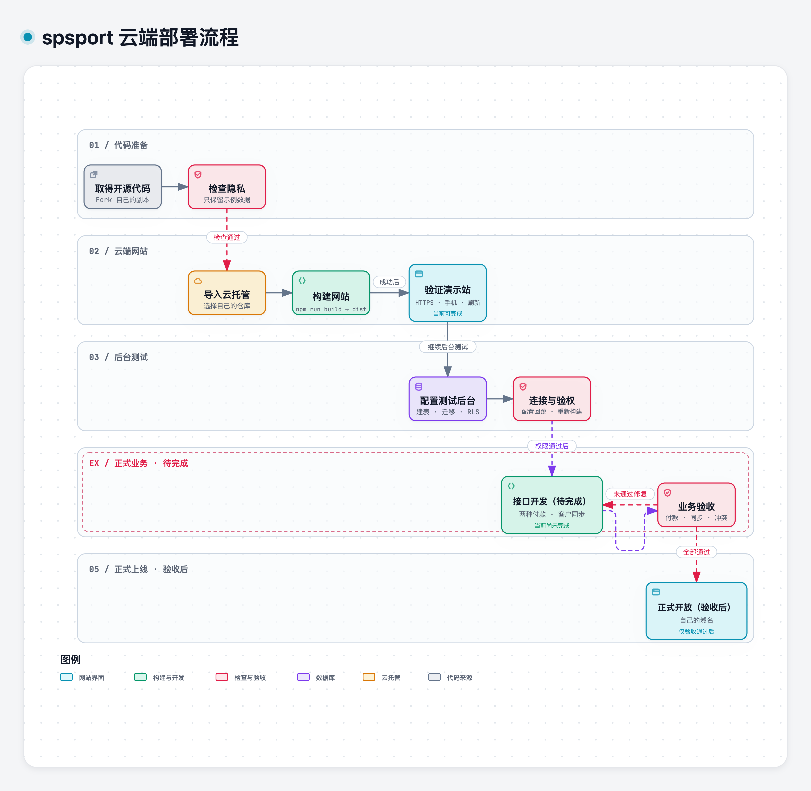
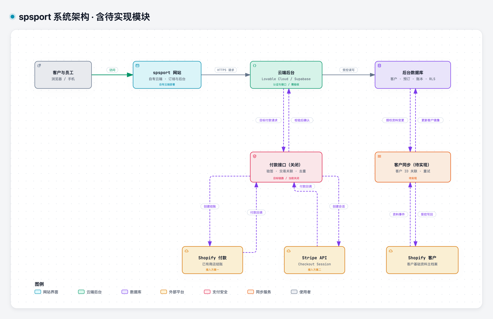

# spsport 云端网站部署指南

本项目的交付方式是：**使用者取得开源代码，在自己的云端托管后台部署网站，再用自己的网址向客户提供订场服务。** 客户访问订场网站，员工登录该网站的管理后台。网站不要求部署到 Lovable。

当前可完成的是云端演示站和隔离的数据库测试环境。正式付款与 Shopify 客户双向同步需要完成开发和验收，不能仅靠填写环境变量开通。

## 1. 先分清三种“后台”

| 后台 | 谁使用 | 负责什么 |
|---|---|---|
| 云托管平台控制台 | 部署者 | 从 GitHub 构建、发布网站、绑定域名、管理前端环境变量 |
| spsport 网站管理后台 | 管理员与员工 | 场地、会员、订单、课程等业务操作，入口为网站的 `/admin` |
| 数据库与服务端控制台 | 有技术权限的维护者 | 数据、认证、RLS、服务端 Secrets、付款回调及同步任务 |

“Lovable 后台数据库”在这里指与网站关联的数据库和服务端能力，不是要求客户访问 Lovable 编辑器或预览页面。当前代码采用 Supabase SDK、SQL 和 Edge Functions；关联 Lovable Cloud 时须单独核对项目配置，详见 [后台关联边界](LOVABLE_SETUP.md)。

## 2. 目标链路

先看部署流程，再看网站与后台的关系。两张图已标明后续开发与验收门槛；付款与客户同步的实现状态见 [接口说明](PAYMENTS_AND_CUSTOMER_SYNC.zh-CN.md)。





[完整图文说明与界面截图](DIAGRAMS_AND_SCREENSHOTS.zh-CN.md) · [可编辑 Mermaid 源文件](diagrams/README.md)

每个部署者使用自己的云项目、数据库和支付账号。当前代码没有完整多租户隔离，不要把多个独立经营者的客户放进同一个共享数据库。

## 3. 准备代码副本

1. 在 GitHub 打开本项目，点击 **Fork**，创建自己的代码副本。
2. 确认副本根目录有 `package.json`、`src` 和 `public`。
3. 不向副本上传客户资料、`.env`、数据库备份或真实截图。

只想先看效果，可以保持仓库原样。修改代码前先核对自己的 Git 公开署名与邮箱设置。

## 4. 在云托管后台创建网站

本指南用项目已有配置支持的 Netlify 说明操作。也可选择能构建 Vite 并支持单页应用回退的云平台；配置项以实际平台为准。[Netlify 部署文档](https://docs.netlify.com/deploy/create-deploys/)

1. 登录你自己的云托管账号，选择从 Git 导入项目。
2. 连接 GitHub，只授权所需仓库，选择刚才创建的副本。
3. 选择要部署的分支，通常为 `main`。
4. 核对以下构建配置：

| 配置项 | 本项目填写值 |
|---|---|
| 项目根目录 | 含 `package.json` 的目录，通常留空 |
| 依赖安装 | 平台自动安装；可配置时使用 `npm ci` |
| 构建命令 | `npm run build` |
| 发布目录 | `dist` |
| Node.js | 22.12 或更高的受支持 LTS 版本 |

5. 初次部署先不填写数据库和支付变量，保留演示模式。
6. 开始部署，等待构建成功，打开平台生成的 HTTPS 地址。

**成功标志：网站显示 spsport，日期、场地和时段可以在同一页选择；演示付款明确提示没有扣款、没有保存。**

构建失败先查看脱敏后的错误，不要把整份日志或环境变量截图发到公开 Issue。需要本地排错时，使用 [本地运行教程](GETTING_STARTED.zh-CN.md)。

## 5. 验证网页和子页面

1. 打开首页，体验日期、场地、连续时段与价格联动。
2. 打开 `/courses`，再刷新页面，确认没有 404。
3. 用手机检查总价和操作按钮。
4. 演示模式中切换管理员，查看管理界面；这只是虚构样例权限。
5. 保留构建输出中的 `_redirects`；其他平台需配置等效的“未知页面路径回退到 `index.html`”规则。

这里只完成网站部署，不代表数据库或收款已经开通。

## 6. 关联自己的云端后台

1. 准备独立测试后台：使用自己的 Supabase 项目，或核对已关联的 Lovable Cloud 后台。
2. 按 [后台配置指南](BACKEND_SETUP.zh-CN.md) 初始化表、迁移、认证和权限；不用真实客户做测试。
3. 在**前端云托管后台**填写公开配置：

   ```dotenv
   VITE_SUPABASE_URL=https://your-project.supabase.co
   VITE_SUPABASE_ANON_KEY=your-public-anon-key
   VITE_DEMO_MODE=false
   VITE_VENUE=spsport
   ```

4. 在**认证后台**把站点 URL、允许的登录回跳地址改为实际云端网站地址，例如 `https://booking.example.com`。
5. 重新构建网站。前端变量在构建时写入，修改变量后仅刷新浏览器不够。
6. 用测试账号登录，验证演示角色切换条消失；普通会员不能进入员工后台或查看他人资料。

`service_role`、支付密钥和 Shopify 管理 API token 只能放在服务端 Secrets，不能使用 `VITE_` 前缀。上传 `dist` 不会部署数据库或 Edge Functions；这些服务必须在后台运行环境独立部署。

## 7. 选择两种付款接入方案之一

| 方案 | 适合情况 | 目标链路 |
|---|---|---|
| Shopify | 已有 Shopify 商店，希望沿用商店结账和客户档案 | 网站下单 → 服务端创建 Shopify 付款入口 → 支付回调确认预订；客户档案与后台双向关联 |
| Stripe API | 使用 Stripe 收款；不要求拥有 Shopify 商店 | 网站下单 → 服务端创建 Stripe Checkout Session → 支付回调确认预订 |

**只规划这两种外部付款接入，不添加第三种。** 客户同步与付款提供商分别配置；已有 Shopify 商店的部署者，即使选择 Stripe 付款，也可以将 Shopify 客户主档案同步作为独立目标功能。

当前 `VITE_PAYMENT_PROVIDER` 仅保留 `shopify` / `stripe` 两个配置值，每次构建选择一个；当前不提供两个可用付款按钮，也不能通过这个变量解除付款关闭。完整目标、字段关联与开发缺口见 [付款与客户同步说明](PAYMENTS_AND_CUSTOMER_SYNC.zh-CN.md)。

## 8. 从测试站转为正式业务前

先完成付款、客户同步和权限验收，再在自己的云托管平台绑定正式域名并开放客户访问。至少要确认：

- 客户身份关联经过验证；不会仅凭相同邮箱把订单交给另一个账号。
- Shopify 客户新增和修改能双向同步，失败有重试、重复事件不重复写入。
- 付款成功、失败、取消、重复及迟到回调的结果正确；不依赖浏览器成功跳转来确认付款。
- 场地冲突、订单过期、退款、权限、备份和恢复均经过测试。
- 域名、HTTPS、登录回跳和服务端回调地址对应同一套环境；测试与正式密钥分开。

当前版本尚未通过这些正式业务验收，问题清单见 [审查报告](REVIEW.zh-CN.md)。部署成功与业务链路完成是两个不同的验收结果。
