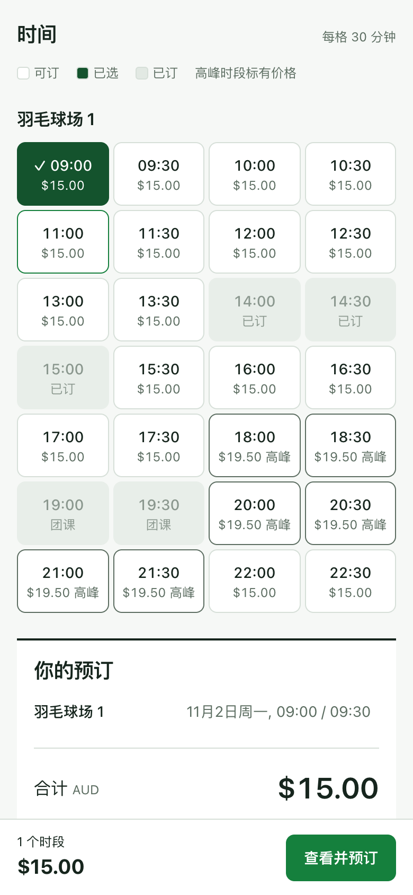
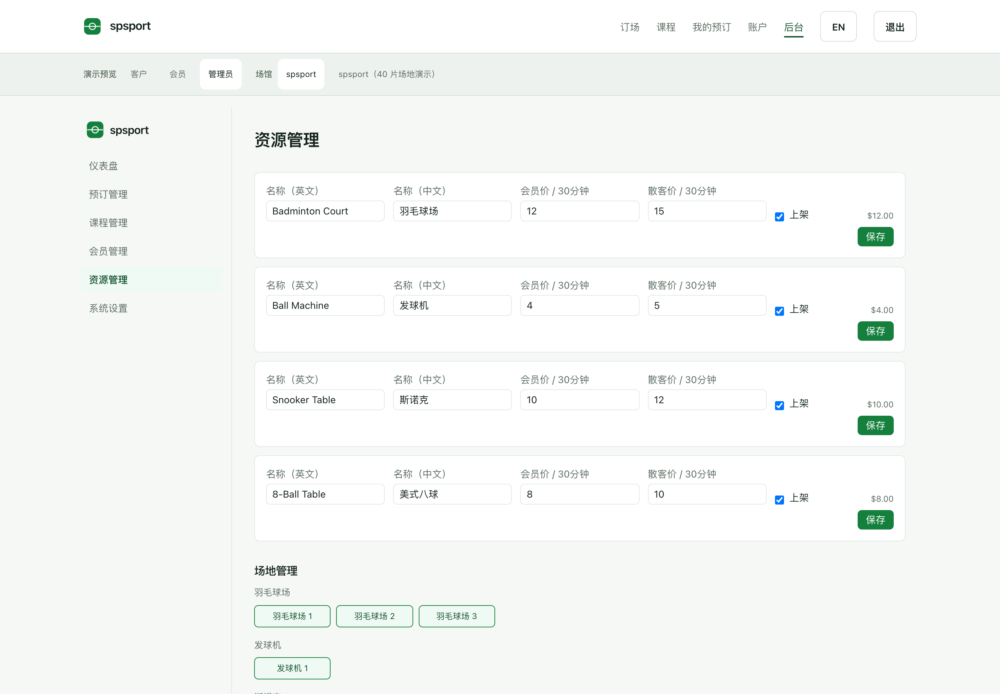

# spsport 部署流程、系统架构与界面截图

这里的图表对应项目的云端交付方案。网站由使用者在自己的云端部署；关联的 Lovable Cloud 或 Supabase 后台需要单独配置和验收。

**当前可部署演示站；真实付款关闭，Shopify 客户双向同步待实现。** 图表中的后续业务阶段不代表本项目已经完成真实收款或客户同步。

## 1. 部署流程图

从开源代码、云端构建、演示站验证，到测试后台、接口开发、正式业务验收。只有完成相应开发并通过验收后，才进入正式网站开放阶段。

[打开高清 PNG](images/cloud-deployment.png) · [Mermaid 源文件](diagrams/cloud-deployment.mmd) · [分步部署说明](CLOUD_DEPLOYMENT.zh-CN.md)

## 2. 系统架构图

网站、数据库和服务端分别承担不同职责。外部付款只有 Shopify 与 Stripe API 两种接入目标；Shopify 客户主档案通过待实现的同步服务与后台关联。图中虚线表示目标链路，不代表付款或同步已开放。

[打开高清 PNG](images/system-architecture.png) · [Mermaid 源文件](diagrams/system-architecture.mmd) · [付款与客户同步说明](PAYMENTS_AND_CUSTOMER_SYNC.zh-CN.md)

同步服务负责客户映射和受控写回，不是让浏览器直接操作 Shopify 管理接口。客户数据同步也不等于两个系统共用登录。

## 3. 桌面订场截图

日期、场地、时段和订单金额在同一页联动。截图来自演示模式，不代表真实空场情况、正式价格或付款记录。

## 4. 手机订场截图

展示窄屏时段选择和固定底部总价入口，按真实手机视口拍摄。完整页面流程可对照桌面截图查看，没有填写真实邮箱或姓名。

[打开手机截图原图](images/booking-mobile-preview.png)

## 5. 管理后台截图

这是 spsport 网站自身的资源管理演示页，不是云托管、Lovable、Shopify 或 Stripe 的真实账号控制台。场地和价格均为虚构样例，不应作为实际经营数据使用。

## 图片维护与隐私

- 图表保留可编辑源文件；业务设计或实现状态变化后同步更新图片。
- 界面截图只在演示模式拍摄，不使用真实会员或管理员账号。
- 发布前人工查看文字，并检查 PNG 的文字与 EXIF 元数据。
- 不上传真实云控制台、支付后台、浏览器账号菜单或带本机用户名的截图。
- 本页没有以模拟控制台冒充真实部署截图；实际平台操作步骤以部署文档为准。
